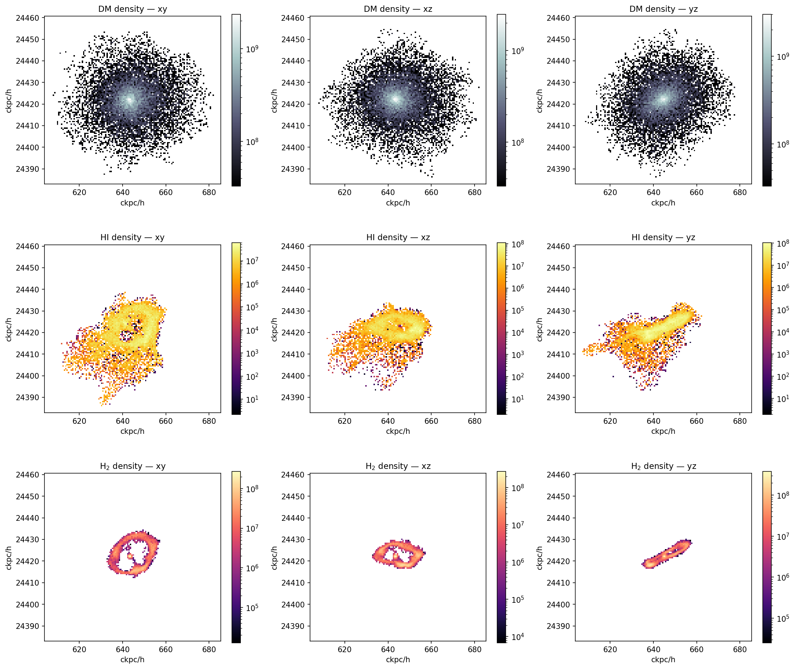

# astrovodka

**Mock resolved HI (21 cm) observations of IllustrisTNG galaxies.**

astrovodka turns SPH particle data into synthetic radio data cubes, with two
departures from [MARTINI](https://github.com/kyleaoman/martini): cosmological
distances come from `astropy.cosmology` rather than a linear Hubble law, and
neutral gas masses come from physically motivated HI/H₂ models rather than a
pressure-based partition.

**English** · [简体中文](README.zh-CN.md)

[](https://github.com/LRayleighJ/astrovodka/actions/workflows/ci.yml)
[](https://www.python.org/)
[](LICENSE)
[](https://doi.org/10.5281/zenodo.11198185)



*Three orthogonal views of TNG-100 snapshot 99 subhalo 113, produced by
`SubhaloDataProducts` under the default `K13_vol` model — dark matter (top), HI
(middle) and H₂ (bottom, on the same spatial scale). The molecular gas traces
the dense inner disc while the atomic gas extends well beyond it.*

---

## What it does

| | |
|---|---|
| **Cosmological distances** | `D_L` normalises the flux, `D_A` sets every angular scale, both from `Planck15`. A galaxy in a `z ≈ 0` snapshot can be placed at any observed redshift. |
| **Four selectable HI/H₂ models** | `GD14_vol`, `GD14_map`, `K13_vol` (default), `K13_map` — the Diemer+2018 pairings of Gnedin & Draine 2014 and Krumholz+ 2013, each in a volume and a projected variant, picked with one keyword. |
| **Adaptive FFT UV field** | The interstellar radiation field is computed per galaxy from a 3D FFT convolution of its star-formation-rate distribution, floored at the Faucher-Giguère+2011 background. |
| **TNG from local disk** | `TNGSource` reads snapshots straight off the filesystem — no web API, no network, no JupyterLab session. |
| **3D data products** | `SubhaloDataProducts` writes gridded UV, DM, HI and H₂ densities in both real and redshift space. |
| **Verified** | The four models reproduce the reference implementation **bit-for-bit** on real TNG-100 subhalos. See [Verification](#verification). |

---

## Installation

```bash
git clone https://github.com/LRayleighJ/astrovodka.git
cd astrovodka

# conda (recommended) — recreates the verified environment
conda env create -f environment.yml
conda activate astrovodka
```

Or with pip, on any Python ≥ 3.9:

```bash
python -m venv .venv && source .venv/bin/activate
python -m pip install -e ".[dev]"
```

| Requirement | Version |
|---|---|
| Python | ≥ 3.9 |
| numpy, scipy, astropy, tqdm | installed automatically |
| **h5py** | optional extra, **required for any TNG workflow** — it reads the snapshots |
| matplotlib, multiprocess | optional: figures, and multi-core insertion |

TNG data is read from local disk. `basePath` must be the directory containing
`groups_<snap>/` and `snapdir_<snap>/`; one TNG-100 snapshot is roughly 1–2 TB
of particle data plus a ~13 GB group catalog.

**Full details — all three install routes, extras, offline/air-gapped cluster
installs, TNG data layout, and a troubleshooting table — are in
[`docs/en/installation.md`](docs/en/installation.md).**

---

## Quick start

### An analytic galaxy, no simulation data needed

```python
import numpy as np
import astropy.units as U
from astrovodka import Martini, DataCube
from astrovodka.sources import SPHSource
from astrovodka.beams import GaussianBeam
from astrovodka.spectral_models import GaussianSpectrum
from astrovodka.sph_kernels import CubicSplineKernel

n = 1000
rng = np.random.default_rng(42)
phi, r = rng.random(n) * 2 * np.pi, rng.random(n) * 10 * U.kpc

source = SPHSource(
    redshift=0.01,                      # cosmology mode: Planck15 D_L and D_A
    ra=30 * U.deg, dec=45 * U.deg,
    T_g=np.full(n, 1e4) * U.K,
    mHI_g=np.full(n, 1e8) * U.Msun,
    xyz_g=U.Quantity([np.zeros(n) * U.kpc, r * np.cos(phi), r * np.sin(phi)]),
    vxyz_g=U.Quantity([np.zeros(n) * U.km / U.s,
                       -100 * np.sin(phi) * U.km / U.s,
                       100 * np.cos(phi) * U.km / U.s]),
    hsm_g=np.full(n, 1.0) * U.kpc,      # smoothing length as FWHM
)

# The spectral axis adopts the units of channel_width unless spectral_unit is set.
datacube = DataCube(
    n_px_x=128, n_px_y=128, n_channels=64,
    px_size=2 * U.arcsec,
    channel_width=5 * U.km / U.s,
    spectral_centre=source.vsys,
    ra=source.ra, dec=source.dec,
)

M = Martini(source=source, datacube=datacube,
            beam=GaussianBeam(bmaj=8 * U.arcsec),
            spectral_model=GaussianSpectrum(sigma="thermal"),
            sph_kernel=CubicSplineKernel())
M.insert_source_in_cube()
M.convolve_beam()
M.write_fits("cube.fits")
```

### A real TNG subhalo

```python
from astrovodka.sources import TNGSource

source = TNGSource(
    basePath="/path/to/TNG/TNG-100/",
    snapNum=99,
    subID=113,
    hi_model="K13_vol",       # or K13_map / GD14_vol / GD14_map
    observed_redshift=0.02,   # distance, decoupled from the snapshot's redshift
    load_subhalo_only=True,   # subhalo particles only; much faster than the FOF group
)

print(source.m_HI_total, source.m_H2_g.sum(), source.f_mol_g.mean())
print(source.D_L, source.D_A, source.vsys)
```

> **Pick your subhalo carefully.** The TNG catalog is sorted by descending
> mass, so `subID=0` is the cluster core — about 38 million gas cells and over
> 10 GB to load. IDs in the 100s are gas-rich satellites that load in seconds.

Runnable versions of both, plus a batch script:

```bash
python examples/en/astrovodka_demo.py                       # analytic galaxy
python examples/en/astrovodka_demo.py --subID 113 --snapNum 99   # needs $TNG_BASE_PATH
python examples/en/batch_subhalos.py --limit 20             # loop over a catalog
```

---

## The four HI/H₂ models

Selected by keyword, anywhere a source or a mass calculation is constructed.

| `hi_model` | Prescription | Projection | Needs stars | Cost |
|---|---|---|---|---|
| `K13_vol` *(default)* | Krumholz+ 2013 | volume (3D) | no | moderate |
| `K13_map` | Krumholz+ 2013 | projected | yes | higher |
| `GD14_vol` | Gnedin & Draine 2014 | volume (3D) | no | moderate |
| `GD14_map` | Gnedin & Draine 2014 | projected | yes | higher |

The **volume** models compute a molecular fraction from the local volumetric
gas density, metallicity and UV field. The **projected** models work from
surface densities instead, which is closer to how the observations are made but
requires projecting the galaxy onto a grid — and therefore a decision about the
gas that falls outside that grid. That fraction is reported as `f_gas_in_map`,
and `TNGSource` warns when it drops below 0.9.

The same physics is available without any observation machinery:

```python
from astrovodka.himodel import METHODS, HIModelConfig, compute_hi_mass

METHODS    # ('GD14_vol', 'GD14_map', 'K13_vol', 'K13_map')

cfg = HIModelConfig(h=0.6774, z=0.0, boxsize_ckpc_per_h=75000.0, ngrid=64)
result = compute_hi_mass(gas, model="K13_map", cfg=cfg, stars=stars, sub=sub)
result.m_hi_msun, result.m_h2_msun
```

See [`docs/en/hi-models.md`](docs/en/hi-models.md) for what each model assumes,
how the UV field is built, and how to tune the numerical settings.

---

## Differences from MARTINI

astrovodka is a fork: the observation machinery is MARTINI's, vendored rather
than imported. What differs:

| | MARTINI | astrovodka |
|---|---|---|
| **Distances** | Linear Hubble law `v = H₀D` | `Planck15`: `D_L` for flux, `D_A` for angular scales |
| **Systemic velocity** | `h·100·D` | Radio convention `c·z/(1+z)`, matching the spectral axis |
| **HI mass** | Pressure-based (Leroy+2008) | Four selectable Diemer+2018 models |
| **H₂ mass** | Not exposed | `source.m_H2_g`, per-particle |
| **UV field** | — | Adaptive per-galaxy FFT field, floored at the UV background |
| **Redshift override** | — | `observed_redshift`: place a `z ≈ 0` galaxy anywhere |
| **TNG access** | Web API + JupyterLab | Local disk |
| **Subhalo loading** | Full FOF group | Subhalo-only (default) or the full group |
| **Centring** | Catalog `SubhaloPos` | DM centre of mass |
| **3D products** | — | `SubhaloDataProducts`: UV, DM, HI, H₂; real and redshift space |
| **Sources implemented** | EAGLE, Simba, FIRE, Magneticum, Colibre, SWIFT, … | TNG only |

The two are also **one-way**: `astrovodka.himodel` is pure physics and imports
nothing from the observation layer, so the mass models can be used and tested
with no data cube anywhere in sight. `tests/test_selfcontained.py` enforces
this, and that no absolute `import martini` exists anywhere in the package.

---

## Verification

The four models were ported expression-by-expression from a reference
implementation that had itself been checked against the authors' original code,
and the port is validated on real data:

- **Bit-for-bit agreement** with the reference on random gas-cell ensembles and
  on real TNG-100 subhalos (4448, 120 and 86902 gas cells).
- **Mass conservation** through the cube: the pipeline reports the fraction of
  the source mass that survives particle pruning, and the tutorial asserts it
  is 100%.
- **End-to-end FITS round trip**: the mass recovered by integrating a written
  cube matches the model's own total.
- **125 unit tests**, needing no TNG data.

The full record — including a measured bug in the previous release's UV
interpolation, which silently collapsed the adaptive field to the uniform
background — is in [`docs/en/verification.md`](docs/en/verification.md).

---

## Documentation

| | |
|---|---|
| [Installation and environment setup](docs/en/installation.md) | All three install routes, extras, offline clusters, TNG data layout, troubleshooting |
| [User guide](docs/en/guide.md) | The concepts, and a complete worked example |
| [HI/H₂ models](docs/en/hi-models.md) | What the four models assume and how to tune them |
| [API reference](docs/en/api/index.md) | Every public class and function |
| [Verification record](docs/en/verification.md) | How the models were validated |
| [Changelog](CHANGELOG.md) | Release history |
| 中文文档 | [`docs/zh/`](docs/zh/index.md) |

A single-file HTML rendering of the full documentation is built from the
Markdown sources with `python docs/build_html.py`, and lands in `docs/html/`.

---

## Examples

| | |
|---|---|
| [`examples/en/tutorial_TNG100-HI-mock-observations.ipynb`](examples/en/tutorial_TNG100-HI-mock-observations.ipynb) | **Start here.** The full walkthrough on a real TNG-100 subhalo: choosing one, switching between the four models, building a cube and the traps in doing so, verifying the result, 3D products, visualisation, troubleshooting. |
| [`examples/en/astrovodka_demo.py`](examples/en/astrovodka_demo.py) | A runnable script: analytic galaxy by default, real TNG subhalo with `--basePath`. |
| [`examples/en/batch_subhalos.py`](examples/en/batch_subhalos.py) | Loop over a subhalo catalog, one cube per object. |
| [`examples/zh/`](examples/zh/) | The same three, in Chinese. |

The notebooks ship with their outputs cleared, so run them yourself. Point
`TNG_BASE_PATH` at your data first:

```bash
export TNG_BASE_PATH=/path/to/TNG/TNG-100/
```

---

## Credits and citation

### Citing astrovodka

If astrovodka contributes to a publication, please cite the model papers
listed in [`NOTICE`](NOTICE) alongside the MARTINI papers below — the HI/H₂
physics is Gnedin & Draine (2014), Krumholz+ (2013) and Diemer+ (2018), not
something this package invented.

### MARTINI

astrovodka is built upon, and includes modified code from,
[MARTINI](https://github.com/kyleaoman/martini). Please cite:

- Oman, K. A. 2024, *J. Open Source Softw.*, 9, 6860.
  [doi:10.21105/joss.06860](https://doi.org/10.21105/joss.06860)
- Oman, K. A., et al. 2019, *MNRAS*, 482, 821.
  [doi:10.1093/mnras/sty2687](https://doi.org/10.1093/mnras/sty2687)
- Oman, K. A. 2019, *ASCL*, ascl:1911.005.
  [ascl.net/1911.005](https://ascl.net/1911.005)

A machine-readable [`CITATION.cff`](CITATION.cff) is included.

---

## License

GNU General Public License v3.0 or later — see [`LICENSE`](LICENSE).

astrovodka is a derivative work of MARTINI, which is distributed under the same
licence; it inherits that licence for all derivative code. [`NOTICE`](NOTICE)
records the provenance of each part, as GPLv3 §5(a) requires.

---

## Contact

**Zerui Liu** — liuzr@bao.ac.cn

Issues and pull requests are welcome at
<https://github.com/LRayleighJ/astrovodka/issues>. See
[`CONTRIBUTING.md`](CONTRIBUTING.md) for how to set up a development checkout.
